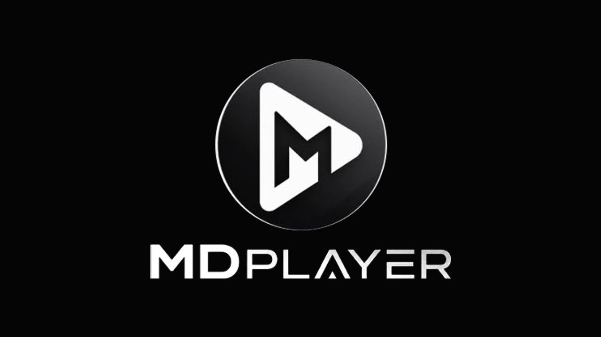
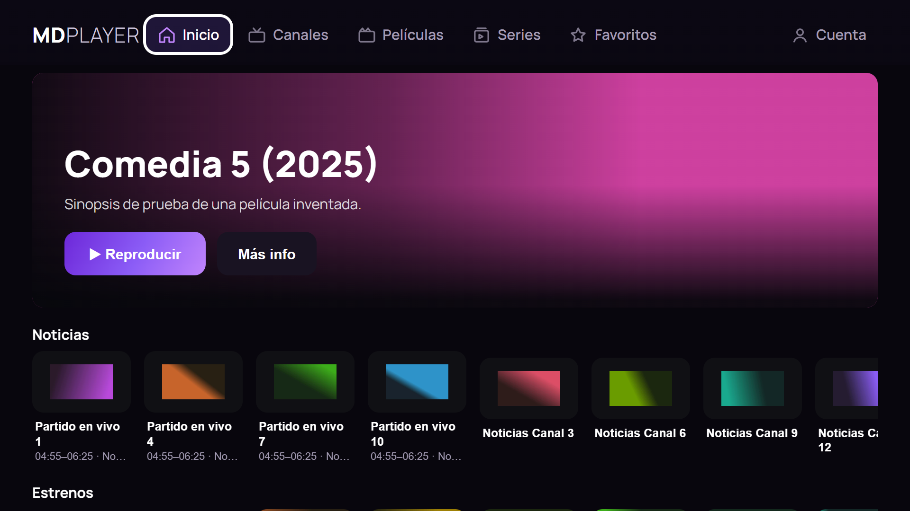
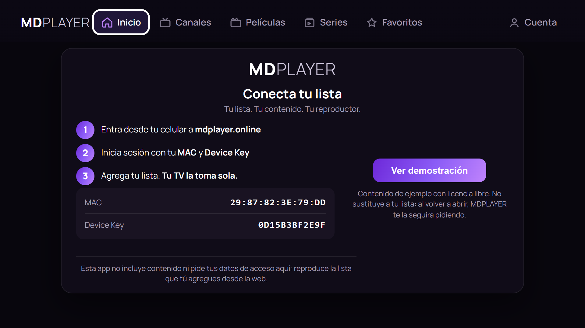
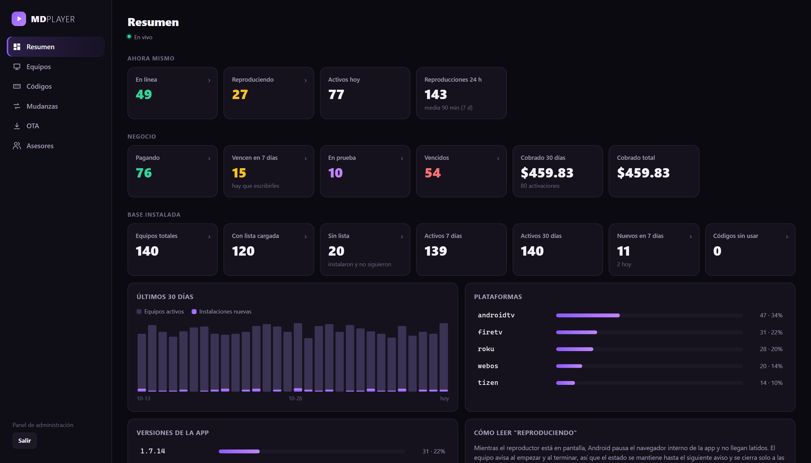
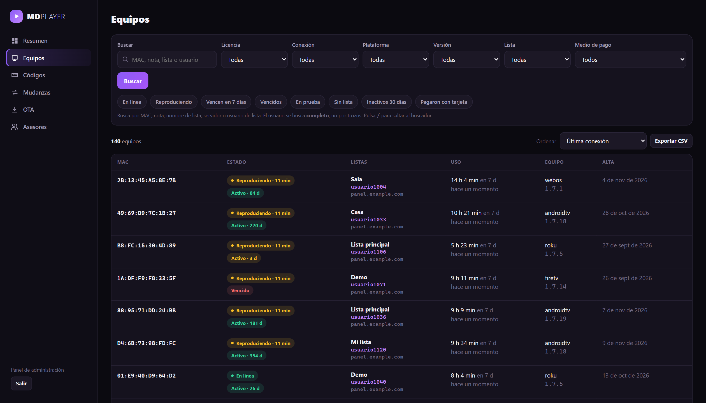
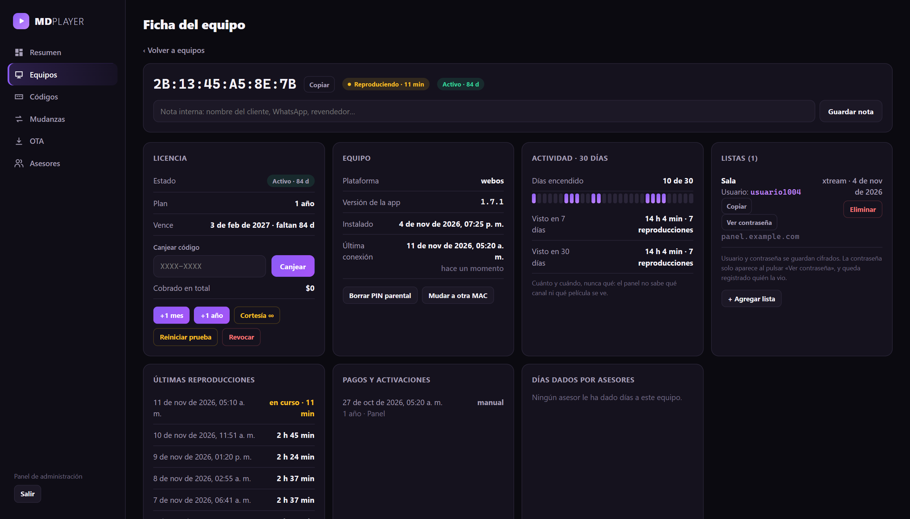
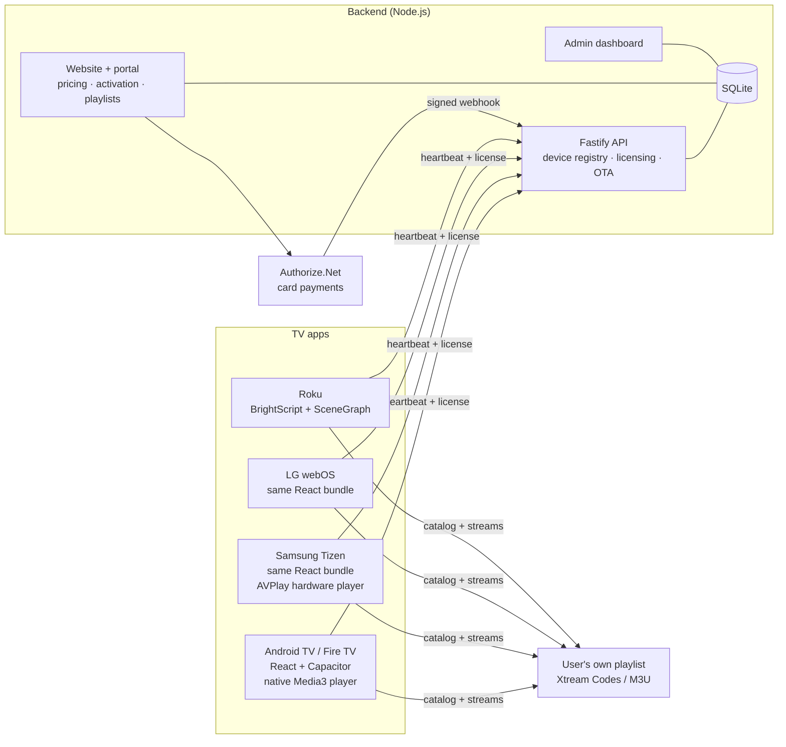

# MDPLAYER — Smart TV media player

**MDPLAYER** is a commercial media player for smart TVs, built and run by
**MDGROUP**. One codebase ships to Android TV, Amazon Fire TV, Samsung Tizen and
LG webOS, plus a native Roku app. It comes with its own backend for licensing,
payments, over-the-air updates and an admin dashboard.

> The source code is private because MDPLAYER is a commercial product.
> I'm happy to walk through the architecture and code in a call.

🌐 **Website:** [mdplayer.online](https://mdplayer.online)

---

## At a glance

| | |
|---|---|
| **Platforms** | Android TV · Amazon Fire TV · Samsung Tizen · LG webOS · Roku |
| **Stores** | Live on the **Amazon Appstore** · in review on Google Play, Samsung and Roku |
| **Install base** | 900+ registered devices, with paying customers |
| **Languages** | Spanish and English across the whole app |
| **Target hardware** | Low-end TV sticks with ~1 GB of RAM |

## Screenshots

**TV app (home screen with sample catalog)**

**First run: the TV pairs with the web portal. No credentials are typed on the TV.**

**Admin dashboard (sample data; no real customers shown)**

---

## Architecture

- **One UI, four platforms.** Android TV, Fire TV, Samsung and LG run the
  *same* React build with different packaging. Platform differences live in a
  single module, so the apps can't drift apart visually.
- **Native playback where it matters.** On Android the player is a native
  Media3/ExoPlayer activity rather than the WebView's `<video>`, to handle live
  MPEG-TS and hardware decoding on weak devices. On Samsung it uses the TV's
  hardware AVPlay pipeline, with a web fallback.
- **The app never takes payments.** Pricing and checkout live only on the
  website, which keeps the app compliant with store payment policies.

## Tech stack

| Area | Technologies |
|---|---|
| **TV interface** | TypeScript, React 19, Vite 7, Zustand, React Router, Norigin Spatial Navigation (remote/D-pad focus) |
| **Android** | Java, Capacitor 8, Media3 / ExoPlayer, FFmpeg audio decoders built with the Android NDK, Gradle product flavors |
| **Smart TVs** | Samsung Tizen (AVPlay), LG webOS, hls.js, mpegts.js |
| **Roku** | BrightScript, SceneGraph |
| **Backend** | Node.js, Fastify, SQLite (better-sqlite3) |
| **Payments** | Authorize.Net (hosted payment + signed webhooks) |
| **Integrations** | Xtream Codes API, M3U playlists, Amazon App Submission API |
| **Tooling & QA** | Playwright, Chrome DevTools Protocol, adb, FFmpeg/ffprobe, oxlint, Git |

## Engineering highlights

- **Fixed a "green screen" on interlaced live channels.** Some broadcasts arrive
  as field-coded H.264, and the second field of every frame has no timestamp.
  The stock player silently dropped those fields, so the picture came out
  distorted and green. I recorded the stream *from the device's own player*,
  analyzed it frame by frame with FFmpeg, and wrote a custom extractor layer
  that recovers the missing fields.
- **Audio that other players handle but ours didn't.** Many regional channels
  use MPEG-1 Layer II audio, and some VOD uses Dolby E-AC-3. Low-end sticks have
  neither decoder, so I compiled FFmpeg decoders for ARM. Along the way I found
  that one CPU architecture had been failing silently for 11 days because of a
  space in a build path.
- **Smooth on 1 GB devices.** I virtualized images in long grids so memory stays
  flat while scrolling. I also scoped spatial-navigation containers so each
  D-pad press is no longer O(N) over every card on screen.
- **Licensing that fails open.** If the server is unreachable, TVs keep working
  on their last valid license for 7 days. An outage on our side never blacks
  out paying customers. A new activation unlocks a TV in under a minute.
- **Privacy by design.** Recommendations are computed entirely on the TV. The
  server never learns what anyone watches.
- **Store-safe builds by construction.** Self-update is compiled only into the
  sideload build through Gradle product flavors, not toggled by a flag. The
  store packages don't contain the installer, the permission, or the code.
- **Automated store releases.** A script drives the Amazon App Submission API
  end to end: it creates an edit, uploads the APK, writes release notes in three
  locales, validates and submits.
- **Regression suites** for licensing, playlist parsing, series metadata,
  packaging, admin search and privacy. They include tests that assert that the
  app's API never exposes prices, and that the admin dashboard never renders
  passwords or IP addresses.

## My role

I founded the product and lead it end to end: product decisions, architecture,
on-device testing, store submissions, payments and operations. I built it using
AI-assisted development (Claude Code) as a pair programmer. I set the direction,
reviewed the work and validated every change on real TVs.

---

### Resumen en español

**MDPLAYER** es un reproductor multimedia comercial para Smart TV, de
**MDGROUP**. Un solo código corre en Android TV, Fire TV, Samsung y LG, y hay
una app nativa para Roku. Tiene su propio servidor para licencias, pagos con
Authorize.Net, actualizaciones automáticas y un panel de administración. Está
publicado en Amazon Appstore, en revisión en Google Play, Samsung y Roku, y
supera los 900 equipos registrados.

El código fuente es privado por ser un producto comercial. Con gusto lo muestro
y explico en una llamada.

---

© 2026 MDGROUP. All rights reserved. This repository contains documentation and
screenshots only. Screenshots use sample data.
